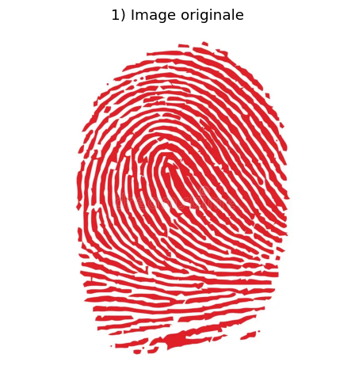
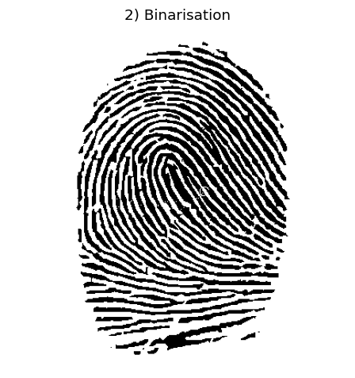
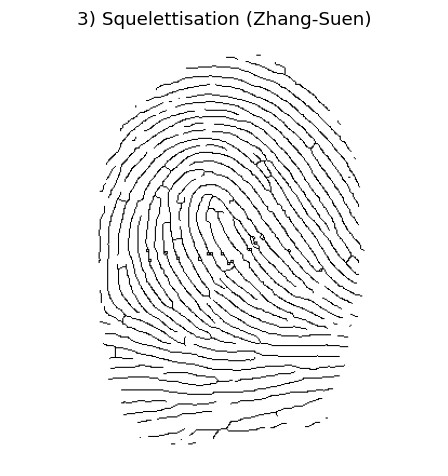
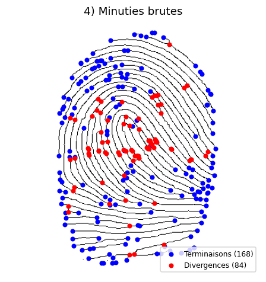
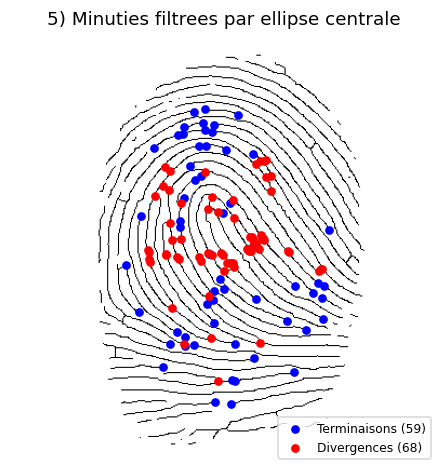

# Empreintes digitales : de l'image à l'identification

Projet de TIPE : numériser une empreinte digitale, en extraire les points caractéristiques (minuties) et retrouver à qui elle appartient dans une base de données.

Tout le traitement d'image est codé à la main en Python (pas d'OpenCV ni de scikit-image) : binarisation, squelettisation de Zhang-Suen, extraction des minuties et comparaison géométrique.

## Le pipeline

| 1. Image originale | 2. Binarisation | 3. Squelettisation |
|:---:|:---:|:---:|
|  |  |  |

| 4. Minuties brutes | 5. Minuties filtrées |
|:---:|:---:|
|  |  |

1. **Binarisation** : chaque pixel devient noir (1) ou blanc (0) selon un seuil sur son intensité. Les grandes images sont réduites à 400 px pour que toutes les empreintes aient une densité de minuties comparable.
2. **Squelettisation (Zhang-Suen)** : on amincit les crêtes jusqu'à une épaisseur d'un pixel, en supprimant à chaque passe les pixels qui ne cassent pas la continuité du trait.
3. **Extraction des minuties** : pour chaque pixel du squelette, on calcule le *crossing number*
   `CN = 1/2 · Σ |P(i+1) − P(i)|` sur ses 8 voisins.
   `CN = 1` donne une **terminaison** (bleu), `CN = 3` une **divergence** (rouge).
4. **Filtrage par ellipse** : on ne garde que les minuties dans une ellipse centrale (80 % des demi-axes), car les bords de l'image produisent beaucoup de fausses terminaisons.
5. **Comparaison** : deux jeux de minuties correspondent si une **translation** ou une **rotation** permet d'en apparier au moins 45 %, chaque minutie ne pouvant être appariée qu'une fois.
6. **Base de données SQLite** : les minuties de chaque empreinte sont enregistrées, puis une nouvelle empreinte est comparée à toutes celles de la base pour l'identifier.

## Résultats

Base de 3 doigts différents, puis identification de `capasse.jpg` (même doigt que `Belle_empreinte.jpg`, tourné d'environ 270°) :

| Paire | Résultat attendu | Obtenu |
|---|---|---|
| Belle / empreinte-digitale-1 | différents | ✅ pas de match |
| Belle / empreinte5_3 | différents | ✅ pas de match |
| empreinte-digitale-1 / empreinte5_3 | différents | ✅ pas de match |
| **Belle / capasse** | **même doigt** | ✅ **match (rotation)** |
| empreinte-digitale-1 / capasse | différents | ✅ pas de match |
| empreinte5_3 / capasse | différents | ✅ pas de match |

`capasse` est correctement identifiée comme l'empreinte n°0 (Belle).

## Lancer le projet

```bash
pip install numpy pillow matplotlib
python empreintes.py      # enrôlement + identification + comparaisons croisées
python demo_visuelle.py   # génère les images des 5 étapes
```

Les calculs sont faits pixel par pixel en Python pur : compter une dizaine de secondes pour traiter les 4 empreintes.

## Fichiers

- `empreintes.py` : tout le pipeline (binarisation, squelettisation, minuties, comparaison, base de données) et un exemple complet.
- `demo_visuelle.py` : sauvegarde une image pour chaque étape du traitement.
- `*.jpg` : empreintes de test.

## Limites

- La comparaison teste une translation **ou** une rotation, pas les deux combinées, et le seuil de 45 % a été réglé sur ce petit jeu d'images.
- Une image bruitée (comme `empreinte-digitale-1.jpg`) produit beaucoup de fausses terminaisons. Un filtrage du squelette (suppression des petites branches) améliorerait la robustesse.
